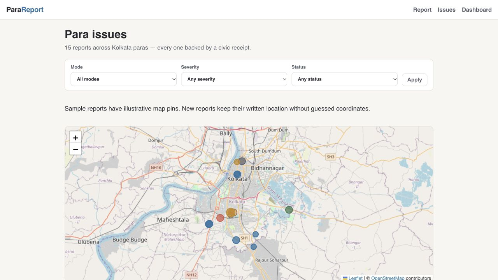

# ParaReport

A Kolkata-focused civic reporting prototype built for a hackathon. Turn a text
report and optional photo attachment into a stored, shareable receipt, then
browse reports through a map and dashboard.



## What works

- Next.js / React / TypeScript interface with eight seasonal reporting modes.
- SQLite persistence, photo attachments, filters, receipts and dashboard counts.
- Deterministic rules by default; optional local and BYOK OpenAI-compatible models.
- Trusted-node federation: signed receipt exchange, resumable sequence cursors,
  duplicate handling and propagation of later status/analysis changes.
- English complaint drafts and Bengali/Hindi share text. Authority submission
  remains a placeholder: nothing is submitted or tracked.

This is a portfolio demo. The 15 initial reports are labeled samples, their pins
are illustrative, and dashboard counts include them. Anonymous status updates
are not independent verification. Photos are stored, not interpreted. Language
and safety suggestions need human review.

## Run

Use Node 24 LTS (Node 22.13+ supports the SQLite backend).

```sh
npm ci
npm run dev
```

Open http://localhost:3000. No model server or API key is required. Reports live
in `data/parareport.db`; photo attachments live in `public/uploads/`. These paths
are untracked. Use synthetic reports: the prototype has no authentication or
private-report access controls.

Set `PARAREPORT_SEED=false` before opening a fresh database to start without
samples. `PARAREPORT_DATA_DIR` selects another SQLite directory. Existing
sample records are retained when changing this setting.

## Optional AI

Local inference uses any compatible `/v1/chat/completions` endpoint, including
llama.cpp or a compatible local server:

```sh
GEMMA_ENABLED=true GEMMA_BASE_URL=http://127.0.0.1:8081/v1 GEMMA_MODEL=my-model npm run dev
```

For llama.cpp, `GEMMA_GGUF_PATH=/path/to/model.gguf npm run gemma:serve`
starts the separately installed runtime. Weights are not included.

For BYOK, open **Bring your own model** in the report form and enter the endpoint,
model and API key. The key stays in tab session storage and transient request
headers; it is not saved in reports or federation payloads. The server makes the
model request. Local endpoints are local to the server, not necessarily the
visitor's phone. Use HTTPS for remote providers.

A rules receipt is saved before optional inference begins. The response may
wait for inference; model failure leaves the saved rules receipt usable and
shows the fallback. Both provider paths use text and attachment hints, not image
pixels. Template language output and model suggestions are not validated facts.

## Show federation

Follow the [two-node walkthrough](docs/FEDERATION_DEMO.md). On each dashboard,
**Check node** shows identity/configuration and **Sync peers** pulls receipts.
Create a synthetic report on node A, sync node B, then change its status on A
and sync B again. Samples and attachments are excluded from federation.

The shared-secret mesh is an experimental trust model, not independent
per-node identity. No automatic authority contact occurs.

## Verify

```sh
npm test
npm run typecheck
npm run lint
npm run build
npm run demo:test
```

`demo:test` starts two production servers on loopback ports 3201–3202 and a
synthetic model stub on 3203, with disposable databases. It verifies exchange,
updates, validation, origin protection, and save-before-AI/BYOK behavior. It
requires a production build and makes no paid calls.

## Scope and limits

The UI retains the original design. There is no real login, full offline browser
storage, geocoding, production moderation, or hosted/Postgres backend. New places
retain written locations without guessed pins or automatic token-based merging.
OpenStreetMap tiles require internet access. All public receipt fields should be
treated as public; redaction and privacy controls are not implemented.

Run the writable demo locally or on a trusted network. Public hosting requires
access controls, upload handling and restricted model egress; the BYOK adapter
allows configured HTTP endpoints for local compatibility. Do not expose it as
an unrestricted public proxy. Larger rebuild plans are retained only in the
local `new` branch; this branch remains the working hackathon application.
