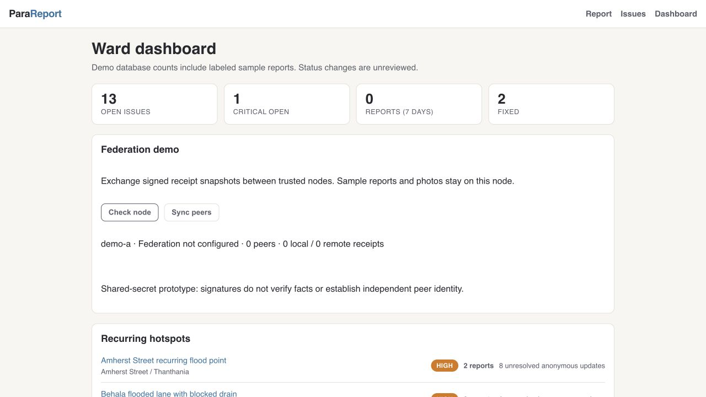
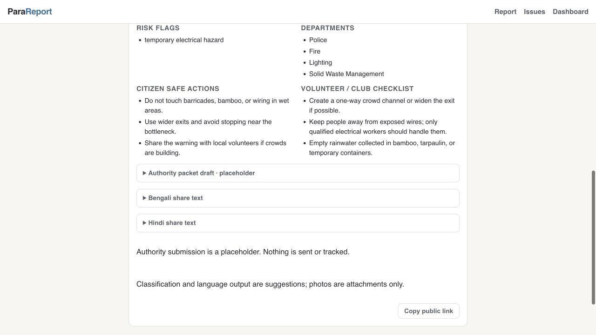

<div align="center">
  
  <h1>ParaReport</h1>
  <p><strong>Local problems. A lasting record.</strong></p>
  <p>A civic reporting prototype for Kolkata’s paras — from a resident’s observation<br />to a saved receipt, a neighborhood map, and a shared record across nodes.</p>
  <p>
    <code>Next.js</code> &nbsp; <code>TypeScript</code> &nbsp; <code>SQLite</code> &nbsp; <code>Local / BYOK AI</code>
  </p>
  <p>
    <a href="#quick-start">Run locally</a> &nbsp;·&nbsp;
    <a href="#inside-the-demo">Explore the demo</a> &nbsp;·&nbsp;
    <a href="#two-nodes-one-shared-record">Try federation</a> &nbsp;·&nbsp;
    <a href="#verification">Verification</a>
  </p>
</div>

<br />


<p align="center"><sub>Hackathon prototype · 15 labeled sample reports · Illustrative map pins</sub></p>

## A report should outlast the conversation

A flooded lane, a broken streetlight, or a blocked drain can disappear into a
chat thread. ParaReport gives the observation a place to live: a stored report,
a structured receipt, and a view of what has been reported around the para.

Built around Kolkata’s seasonal problems, the prototype brings together report
intake, SQLite persistence, map views, optional model analysis, and signed
receipt exchange between trusted nodes.

## Inside the demo

| Capture | Understand | Keep track |
| --- | --- | --- |
| Write a report and attach a photo. Save it to SQLite before optional inference begins. | Generate suggested severity, risk flags, action checklists, and share text using rules or a configured model. | Browse receipts, filter the map/feed, record demo status changes, and exchange updates with another node. |

<table>
  <tr>
    <td width="50%"></td>
    <td width="50%"></td>
  </tr>
  <tr>
    <td align="center"><sub>Dashboard &amp; node exchange</sub></td>
    <td align="center"><sub>Structured receipt &amp; share text</sub></td>
  </tr>
</table>

**Eight seasonal modes:** Everyday · Summer heat & water · Storm preparation ·
Monsoon flood & dengue · Pujo safety · Post-Pujo cleanup · Winter air & dust ·
Wetlands watch.

Receipts include English complaint drafts and Bengali/Hindi share text.
**Authority submission is a placeholder:** nothing is submitted or tracked.
Photos are attachments, not image analysis; classification, language output,
and safety suggestions need human review.

## Quick start

Use **Node 24 LTS**. The SQLite backend requires Node 22.13 or newer.

```sh
git clone https://github.com/kanishkpaul/parareport.git
cd parareport
npm ci
npm run dev
```

Open [localhost:3000](http://localhost:3000). No API key, model download, or
model server is required.

The first database open loads 15 sample reports. Explore the map, save a
synthetic report, open its receipt, then reload to see the persisted record.
Dashboard totals include samples; anonymous updates are not independent checks.

<details>
<summary><strong>Storage and a blank demo database</strong></summary>

Reports live in `data/parareport.db`; photos live in `public/uploads/`. Both
paths are untracked.

To start a fresh database without samples:

```sh
PARAREPORT_SEED=false PARAREPORT_DATA_DIR=./data/blank-demo npm run dev
```

This leaves the existing database intact. Changing the seed setting does not
remove sample records already stored. `PARAREPORT_DATA_DIR` changes the database
location; photo uploads still use `public/uploads/`.

</details>

## Your choice of analysis

| Mode | Setup | Behavior |
| --- | --- | --- |
| **Rules — default** | None | Deterministic classification and language templates; no inference request. |
| **Local model** | An OpenAI-compatible endpoint, such as llama.cpp | Optional text analysis through your configured local server. |
| **BYOK** | Endpoint, model, and key in **Bring your own model** | Optional text analysis through the provider you select. |

A rules receipt is durable **before** an optional model call starts. The
response may wait for inference; failure retains the saved rules receipt and
shows the fallback. Neither provider path inspects photo pixels.

<details>
<summary><strong>Connect a local model</strong></summary>

Point the app at a compatible `/v1/chat/completions` endpoint:

```sh
GEMMA_ENABLED=true \
GEMMA_BASE_URL=http://127.0.0.1:8081/v1 \
GEMMA_MODEL=my-model npm run dev
```

For a separately installed llama.cpp runtime:

```sh
GEMMA_GGUF_PATH=/path/to/model.gguf npm run gemma:serve
```

Model weights and native inference runtimes are not bundled with the app.
“Local” means local to the application server, not necessarily the visitor’s phone.

</details>

<details>
<summary><strong>Use your own provider</strong></summary>

Open **Bring your own model** in the report form and enter an OpenAI-compatible
base URL, model name, and API key. Use HTTPS for remote providers.

The key stays in tab session storage and transient request headers. It is not
saved in reports or federation payloads. The application server makes the model
request. If the provider fails, the receipt uses rules rather than silently
switching to a different model provider.

</details>

## Two nodes, one shared record

Create a report on **node A**, sync **node B**, then change the status on A and
sync again. B receives the newer snapshot without creating a duplicate.

- **Sequence cursors** cover new reports and later edits, including timestamp ties.
- **Signed snapshots** are validated before import and namespaced by origin.
- **Origin-only updates** keep imported receipts read-only on receiving nodes.
- **Bounded pulls** resume from stored progress when a peer comes back online.
- **Sample reports and attachments** stay out of the federation feed.

On the dashboard, use **Check node** and **Sync peers** to show the exchange.
The [two-node walkthrough](docs/FEDERATION_DEMO.md) includes setup commands,
a demo sequence, and protocol details.

This is a shared-secret prototype. Its signatures establish shared-secret
provenance, not factual truth or independent per-node identity. Intermediate
states and deletions are not replicated.

## Under the hood

| Layer | Implementation |
| --- | --- |
| Interface | Next.js App Router, React, TypeScript, Leaflet |
| Persistence | Node’s built-in `node:sqlite`, with a local change journal |
| Analysis | Deterministic rules and optional OpenAI-compatible adapters |
| Federation | HMAC-SHA256 snapshots, sequence pagination, newer-origin updates |
| Verification | Node test runner and a disposable two-node production smoke test |

## Verification

```sh
npm test
npm run typecheck
npm run lint
npm run build
npm run demo:test
```

The suite contains **40 tests** covering providers, storage, migration,
signing, and federation regressions. The production smoke test starts two
servers and a synthetic model stub on loopback ports 3201–3203. It checks
receipt exchange, later updates, validation, origin protection, save-before-AI,
and BYOK behavior, using disposable databases and no paid calls.

See [verification notes](docs/TESTING.md) for the checked evidence, manual
walkthrough, and remaining development dependency advisories.

## Prototype boundaries

Use synthetic reports and run the writable demo locally or on a trusted network.
There is no authentication, private-report access control, redaction, production
moderation, full offline browser storage, or hosted/Postgres backend.

New places retain their written locations without guessed pins or automatic
location-token merging. OpenStreetMap tiles require internet access. Public
hosting needs access controls, safer upload handling, and restricted model
egress; local/BYOK compatibility does not make the server a safe public proxy.
